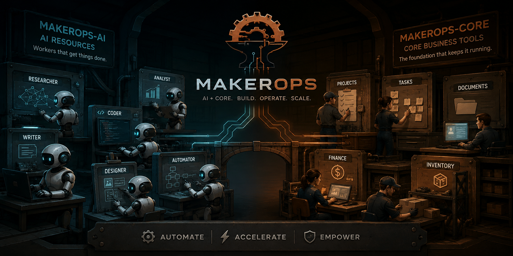

# MakerOps AI

The agentic AI ecosystem layered on the public
[makerops-core](https://github.com/makerops-labs/makerops-core) stack: chat
UI, agent workspace, tool server, private web search, speech, and
persistent-memory tooling — everything that composes the foundational
inference services into an agentic system. Runs entirely on-premise; no API
keys, no data leaving the host, no per-token costs.

Split from core (2026-07-04, core's public history scrubbed of AI-ecosystem
work) to keep the two repos' version control separate; both are now public,
but the split itself stays — this repo holds the agentic AI tooling, core
holds the business services and foundational GPU services (Ollama, ComfyUI).

## Prerequisites (from makerops-core)

These services depend on the sibling checkout of `makerops-core`:

- **Ollama** (`makerops-core/ai/ollama`, port 11434) — serves every LLM here.
  Model pulls are listed in [docs/ai-setup-checklist.md](docs/ai-setup-checklist.md).
- **ComfyUI** (`makerops-core/ai/comfyui`, port 8188) — image generation,
  driven via mcp-tools.
- **name-proxy** (`makerops-core/infrastructure/name-proxy`) — optional
  `*.localhost` names for the services here; enable with the drop-in in
  [proxy/](proxy/) (install/uninstall = copy/delete one file).
- NVIDIA Container Toolkit for the GPU services (documented in
  makerops-core's `ai/README.md`).

## Setup

The complete, ordered walkthrough is
**[docs/ai-setup-checklist.md](docs/ai-setup-checklist.md)** — work it top to
bottom; each phase is independently useful. In outline:

1. Start Ollama (in makerops-core) and pull the models from the hierarchy
   table, including the `qwen3.5:9b-64k` derivative (checklist §1).
2. Start SearXNG, then mcp-tools (note the approvals URL+token it prints),
   then Open WebUI / smolagents / speech. Each `start.sh` creates `.env`
   from `.env.example` on first run.
3. Add service API tokens to `mcp-tools/.env` one at a time (checklist §2) —
   domains without a token simply stay unmounted.
4. Do the UI-side wiring in Open WebUI (checklist §3–4): web search, tool
   connections, RAG embedding model, audio, and the workspace-model presets
   from [openwebui/contexts/](openwebui/contexts/) (git is the source of
   truth; the UI stores them in its DB).
5. Optional: name-proxy drop-ins ([proxy/README.md](proxy/README.md)) and
   Hermes ([docs/hermes-setup.md](docs/hermes-setup.md)).

## Services

| Service | Port | Purpose |
| ------- | ---- | ------- |
| [Open WebUI](https://openwebui.com) | [8080](http://localhost:8080) | Chat UI — conversation history, RAG, multi-model support, voice |
| [smolagents](https://github.com/huggingface/smolagents) | [8090](http://localhost:8090) | Agent workspace — planning, research, coding, ops, and audit agents with a Gradio UI |
| [SearXNG](https://github.com/searxng/searxng) | [8098](http://localhost:8098) | Private metasearch — web-search backend for Open WebUI and mcp-tools |
| MCP Tools | [8099](http://localhost:8099/healthz) | Shared MCP tool server — read/write tools for the business stack with human write-approvals |
| [n8n-mcp](n8n-mcp/) | [8104](http://localhost:8104/health) | MCP server for agentic n8n workflow management (czlonkowski/n8n-mcp) — wraps the makerops-core n8n public API with node schemas, templates, and validation. Feeds the "n8n Architect" preset (direct) and the `n8n_builder` persona (via an mcp-tools `n8nmcp` proxy domain). Destructive tools disabled in-process; no approval gate on this path |
| [Speech](speech/) | [8091](http://localhost:8091) STT / [8093](http://localhost:8093) TTS | speaches (faster-whisper) speech-to-text + Kokoro text-to-speech, CPU-only |
| [TRELLIS](trellis/) | [8094](http://localhost:8094/healthz) | Image-to-3D generation (GLB) — GPU-heavy, start-on-demand only |
| [redeploy](redeploy/) | [8101](http://localhost:8101/healthz) | Docker-socket-scoped restart proxy — deploys approved self-improvement code changes |
| [sandbox](sandbox/) | [8102](http://localhost:8102/healthz) | Docker-socket-scoped command runner — sandboxed shell execution (tests/lint/build/git) confined to one project directory, no host/Docker access from inside |

There is also one host-level (non-Docker) component:
[Hermes Agent](https://hermes-agent.nousresearch.com), a terminal agent with
persistent per-project memory that runs against Ollama — see
[docs/hermes-setup.md](docs/hermes-setup.md).

### Using the stack day to day

- **Chat** at <http://localhost:8080> (or `openwebui.localhost`): pick a
  workspace-model preset (Research Assistant, Ops Assistant, Coding
  Assistant, …) rather than a bare model — presets carry the right system
  prompt, tool scope, and baseline context. Attach an image to any
  qwen3.5/qwen3.6 chat for vision; use the mic/speaker buttons once speech
  is wired.
- **Agents** at <http://localhost:8090> (or `agents.localhost`): give the
  manager a task; it delegates to web_researcher / coder / ops / auditor.
  Ask for a "review" or "second opinion" to trigger the multi-model audit.
- **Second opinions**: paste task + artifact into the Code Auditor or
  General Auditor preset (manual), or let the smolagents auditor consult the
  reviewer pool (automated). Reviewers are deliberately weaker,
  different-lineage models — weigh their findings, don't auto-apply.
- **Write actions** (wiki edits, stock adjustments, …) may answer
  `PENDING APPROVAL #id`: review and approve at
  <http://mcp.localhost/approvals>. Additive writes notify; destructive ones
  gate — tune per tool in `mcp-tools/.env`.

### Tool discovery (progressive disclosure)

mcp-tools publishes a documentation tree so agents (and humans) can discover
tools without carrying the whole catalog in context:

| Level | HTTP | From any agent |
| --- | --- | --- |
| Domain manifest | `GET :8099/context` | `tools_help('')` |
| One domain's tools | `GET :8099/context/<domain>` | `tools_help('<domain>')` |
| Full usage for one tool | `GET :8099/context/<domain>/<tool>` | `tools_help('<domain>/<tool>')` |
| Best-practice guidance | `GET :8099/context/guidance[/<doc>]` | `tools_help('guidance[/<doc>]')` |

The `guidance` branch serves [docs/guidance/](docs/guidance/) — distilled
operating best practices (planning discipline, external verification,
tooling for small models) that agents pull on demand; also mirrored to the
Outline "Guidance" collection for RAG.

Every agent gets the root manifest as baseline context automatically:
smolagents injects it into all agents' instructions (`agents/context.py`),
Open WebUI presets start with [contexts/_baseline.md](openwebui/contexts/_baseline.md),
and Hermes profiles learn it once into persistent memory.

### Model hierarchy

The stack follows a **lead-per-domain** convention: each expertise domain has
one lead model (the best benchmark performer that runs on this hardware), and
multi-model review uses same-expertise models with *lower* benchmark scores as
supplementary reviewers to catch the lead's blind spots. Reviewer pools
deliberately include a different lineage (gpt-oss, OpenAI) so the models don't
share training blind spots. Since 2026-08-26, "best that runs on this
hardware" splits by **workload latency sensitivity**, not just by domain:
interactive/chat-facing roles keep the fastest good-enough model, while
unattended background queues (devteam engineer phases, the hardware
specialist below, reviewers) can afford a slower, higher-benchmark model —
the machine sits idle between jobs anyway. See `docs/model-stack.md`'s
2026-08-26 pass. **Any `qwen3.8:27b` usage in this stack means the
`-64k` derivative, never the bare tag** — the bare tag's reasoning
exhausts Ollama's 4k default context before producing output (observed
2026-08-28; see that doc's 2026-08-28 note).

| Domain | Lead | Reviewers |
| --- | --- | --- |
| Coding (interactive — chat coder, Coding Assistant preset) | `qwen3.6:35b` (73.4% SWE-bench Verified) | `qwen3.8:27b-64k`, `gpt-oss:20b` |
| Coding (background — devteam engineer phases) | `qwen3.8:27b-64k` (dense; successor to qwen3.6:27b — SWE-bench Pro 61.7% vs 53.5%, Terminal-Bench 2.1 73.0% vs 63.4%; same footprint, ~14 tok/s here, fine for unattended phases; **-64k required** — this model's reasoning exhausts Ollama's 4k default before producing output, observed 2026-08-28) | — |
| KiCad build-plans (hardware specialist) | `qwen3.8:27b-64k` (dense, structure-precise; same as above — reviewer/specialist-class speed, not the interactive lead) | — |
| Default chat / task dispatch | `qwen3.6:35b-64k` (derivative, checklist §1) | — |
| General / agents / planning | `qwen3.6:35b-64k` (same derivative — one resident general model for chat and agents) | `qwen3.5:9b`, `gpt-oss:20b` |
| Vision understanding | `qwen3.5:9b` / `qwen3.6:35b` (both natively multimodal) | — |
| Image generation | FLUX.1 (ComfyUI, in makerops-core) | — |
| Image-to-3D | `TRELLIS-image-large` 1.2B (trellis service, GPU on-demand) | — |
| Speech (TTS, agent-usable) | Kokoro-82M (speech service, CPU) | — |
| Embeddings (RAG) | `qwen3-embedding:0.6b` | — |

The review workflow is exposed two ways: the **Code Auditor / General
Auditor** presets in [openwebui/contexts/](openwebui/contexts/) (manual), and
the smolagents **auditor** agent (automated — see
[smolagents/README.md](smolagents/README.md)). When a new model release beats
a lead on domain benchmarks and fits the hardware, the old lead becomes a
reviewer candidate and configs move on: `SMOLAGENTS_*_MODEL_ID` env vars, the
context presets, and this table.

The **debate** system (below) applies the same reviewer-decorrelation
reasoning to a different kind of task: its entrepreneur and monitor personas
default to the default-chat lead `qwen3.6:35b-64k` (both make judgment calls
where quality matters more than the multi-minute VRAM-swap cost, which is
fine for an unattended background tool), while its critic persona defaults to
`gpt-oss:20b-32k` — a context-bumped derivative (checklist §5h) of the same
cross-lineage model used in the reviewer pools — specifically so it doesn't
share the other two personas' blind spots. (The derivative exists because
the base model serves at Ollama's 4k default context, which truncates a
debate turn mid-answer; the reviewer pools still use base `gpt-oss:20b`,
whose short review prompts fit, but a long artifact review would hit the
same ceiling — switch the pool to the -32k derivative if that shows up.)

### Self-improvement loop

The stack can research, evaluate, and propose improvements to *itself* —
the goal being that you provide direction and approvals, not legwork. The
**maintainer** agent (part of the smolagents roster, see
[smolagents/README.md](smolagents/README.md)) reviews recent job and audit
history for concrete, evidenced failure patterns, *and* sweeps external
sources (arxiv/github/scholar/stackoverflow/general web, plus X/Twitter if
`X_API_BEARER_TOKEN` is configured) for new AI-tooling techniques worth
adopting — tracked in two self-bootstrapping Outline docs (a Research
Ledger of findings/decisions, a Research Query Log of what's already been
searched) so repeat sweeps only look at what's new. It researches fixes
(delegating to web_researcher via the manager), writes an evaluation report
to Outline's **AI** collection, and files one issue per proposed
improvement in the **Stack Improvements** Plane project. For well-scoped
proposals the manager has `coder` draft the actual file content and then
proposes it itself with `propose_code_change`.

**Every actual code change is a human-reviewed diff, no exceptions.**
`propose_code_change` has no file-path restriction — gating on your
approval at [mcp.localhost/approvals](http://mcp.localhost/approvals) is
the safety boundary, not an allowlist. Nothing is written until you
approve. On approval, the affected container (`smolagents` or `mcp-tools`
— the only two with live-editable bind-mounted code) restarts
automatically via the [redeploy](redeploy/) service; if it fails its
health check, the change is **automatically reverted** and the container
restarted again onto the known-good version — you find out what happened
(healthy or reverted) through the same `/approvals` page and notification
webhook you already use for everything else, not a new place to check.

**Your responsibility**: pending code-change approvals expire after
`APPROVAL_TTL_HOURS` (24h default) exactly like any other gated action —
review them or they're simply lost, not queued forever. And a clean
restart only proves the new code *runs*; it doesn't prove it's *correct*
— that judgment call is why review exists. See
[docs/ai-setup-checklist.md](docs/ai-setup-checklist.md) "Self-improvement
loop" for the one-time setup and a full walkthrough of the expected
process, and this file's Gotchas section below for failure modes to watch
for.

Trigger a review on demand by asking any dispatch-capable chat (e.g. Task
Dispatcher) to "review the stack's recent performance and propose
improvements" — this always includes the external trends sweep, not just
internal history — or set up the optional weekly n8n cron workflow
described in the checklist.

### Debate system

A fixed team of three personas — **entrepreneur** (proposes and defends the
strongest concrete version of an idea), **critic** (independent devil's
advocate), and **monitor** (neutral facilitator; decides
continue/redirect/conclude) — argues a goal over several rounds. Because all
of them share one GPU, they run one at a time in series, correspondence-chess
style: each turn is a background job that writes its argument to a file and
automatically queues the next persona's turn once it finishes — no polling
loop or scheduler to babysit, it reuses the same file-based job-queue
mechanism as `agent_dispatch` (see `smolagents/agents/jobs.py`).

Each round is kept small (a one-line abstract plus a focused argument,
hard-capped in size), but the debate as a whole stays navigable via a
**manifest**: a sequenced, append-only index (round number, persona, word
count, one-line description, file path) that a turn's own prompt renders
compactly — recent rounds in full, older ones as a description a persona can
choose to read in full or skip, so context stays flat no matter how long the
debate runs. Round files are prose by contract, doubly enforced: each
persona carries an output contract plus a format check that rejects
code/JSON answers with corrective feedback (`agents/debate/format.py`), and
the worker deterministically unwraps anything that still arrives
code-fenced before it becomes the next turn's input.

**Every debate ends with a human-facing synthesis, automatically.** When
the monitor concludes (or the round cap is hit), one closing monitor turn
writes the final report — what was decided or learned, the strongest
surviving objections, concrete next steps, open questions — to the
session's `summary.md`, served by `debate_result`. That report is the
deliverable; the round files are the working record behind it. A turn runs
its persona **directly** — the worker assembles the persona's task,
enforces the prose contract, and regex-parses the monitor's verdict, all in
deterministic code; there is deliberately no orchestrator LLM between the
worker and a persona (an earlier relay design failed constantly by
re-typing arguments into giant string literals). Personas carry their own
web tools for grounding claims; deeper sourced research is available via
the dedicated **researcher** agent through the general manager or the
Researcher preset.

Start one from the **Debate Moderator** chat preset (it refines an ambiguous
ask into a concrete goal/mode/deliverables brief with you first, the same way
Task Dispatcher refines a brief before `agent_dispatch`), or call
`debate_start` directly if you already have one. `mode="narrow"` keeps a
tight, well-scoped question concrete (6 rounds by default); `mode="broad"`
lets the personas research and range wider over an open-ended one (16 rounds
by default). Track a running debate with `debate_status` / `debate_manifest`
/ `debate_read_round`, and read the final synthesis with `debate_result`; a
turn that crashes or ends `needs_attention`/`failed`
halts auto-advancement (status `stuck`, with a `stop_reason`) rather than
silently stalling or queuing garbage into the next turn — recover it with
`debate_resume` or give up with `debate_cancel`.

### Project workspaces

Beyond improving itself, the stack can research a problem, propose a
solution, and — once you've reviewed the proposal and created a directory
for it — implement the code and docs there. This is the `project` MCP
domain (see [mcp-tools/README.md](mcp-tools/README.md) "Project
workspaces"): durable directories that are **siblings of `makerops/`**
under `~/workspace/` (e.g. `~/workspace/my-app`), never nested inside
`makerops-ai` or `makerops-core`.

- **You create the directory by hand** — that's the authorization to write
  there; the agents never create it for you. Register it with
  `project_register`, then dispatch work with `agent_dispatch(...,
  project="my-app")`.
- **Reads span all of `~/workspace`** (sibling projects, even this stack's
  own source) so agents can use existing work as prior art; **writes stay
  confined** to the one project you registered for that job.
- **Notify tier by default** — writes execute immediately, since creating
  the directory was already your approval; audit-logged and
  webhook-notified like everything else, not gated per file.
- Every registered project gets a `PROJECT_CONTEXT.md` seeded at its root —
  current state, architecture, and pointers to detail docs — so a
  stateless agent picking the project back up later (a different job, a
  different day) isn't starting from nothing.

#### Sandboxed command execution

File I/O alone can't verify anything — an agent can write a test and claim
it passes without running it. `project_run_command` (also in the `project`
domain) runs a bounded shell command (test runner, linter, build, `git`,
package install) inside an isolated, resource-capped, ephemeral container
with exactly one registered project directory mounted — nothing else, and
no Docker access from inside it. See [sandbox/README.md](sandbox/README.md)
for the full containment model (resource limits, non-root user, network
policy). Like file writes, this executes immediately (notify tier) — the
sandbox itself is the safety boundary, not a human-approval step, since
that would break the "run it, read the output, iterate" loop this exists
for. `coder` and `manager` both use it; before reporting a project job
done, the manager has `coder` actually run the test suite rather than
assume the code works.

### Devteam engagements (build an app from a product plan)

The dev-shop tier on top of project workspaces: a **lead architect** agent
orchestrating a specialist software team (product analyst, five role-briefed
engineers, security reviewer, tech writer, plus the shared auditor and
researcher — `smolagents/agents/devteam/`) builds an entire application in
a registered project directory from a product plan you provide, phase by
phase: requirements → architecture → scaffold → implementation milestones
(planned by the architecture phase itself) → qa → docs. Each phase runs as
one background job through the same segment/synopsis machinery as any long
manager job; the engagement's durable state machine lives in
`smolagents/data/smolagents/devteam/<id>/session.json` (a fourth parallel
queue beside jobs/debates/liaison, same mcp-tools bind-mount ownership
split).

Two things distinguish it from `agent_dispatch`:

- **It can ask you questions mid-run.** When the architect hits a real
  product decision, the engagement parks as `awaiting_input` (webhook
  `devteam.needs_input` carries the questions), and resumes — same phase,
  same working memory — when you answer via `devteam_answer`. No more
  "the team cannot ask questions mid-run".
- **You sign off like a client, not a babysitter.** Phases listed in the
  engagement's `gates` (default `key`: requirements, architecture, final
  docs delivery) park as `awaiting_review` until you `devteam_approve` or
  `devteam_revise` (rework with your feedback injected verbatim);
  everything between gates auto-advances — the worker queues the next
  phase itself, debate-style, notifying you informationally at each
  milestone. `gates="all"` or `"none"` change the contract per
  engagement. Within a phase nothing is people-gated at all: project
  writes and sandboxed runs are notify-tier, so the team iterates freely.

Start one from the **App Builder** chat preset
([openwebui/contexts/app-builder.md](openwebui/contexts/app-builder.md)) —
it interviews you into a concrete plan, registers the project, calls
`devteam_start`, relays questions, and records your verdicts. Track with
`devteam_status` / `devteam_result` or the inbox's engagement cards; a
crashed or failed phase parks as `stuck` (webhook `devteam.stuck`) and
recovers with `devteam_resume`, or `devteam_cancel` ends the engagement
(project files always remain). An architecture phase that fails to produce
a machine-parseable milestone plan is parked `stuck` too — the plan is
validated by deterministic worker code, never guessed.

### Hardware engagements (design a circuit from a desired outcome)

The same engagement mechanism as devteam above, applied to circuit design:
an **embedded architect** agent orchestrating a **KiCad build-plan
specialist** (`smolagents/agents/hardware/`) designs a circuit in a
registered project directory from a desired hardware outcome you provide,
phase by phase: requirements → architecture (with a per-block milestone
plan, one block per functional area — power, MCU, sensing, radio, etc.) →
per-block implementation milestones → fab-review → docs. Each phase runs
as one background job through the same segment/synopsis machinery as any
long manager job; the engagement's durable state machine lives in
`smolagents/data/smolagents/hardware/<id>/session.json` (a fifth parallel
queue beside jobs/debates/liaison/devteam, same mcp-tools bind-mount
ownership split). This is a deliberately forked, parallel implementation
of the devteam mechanism, not a shared one — see
`smolagents/agents/jobs.py`'s hardware section for why forking (rather
than generalizing devteam itself) was the right call for this pass.

**No real KiCad tooling exists yet.** Every phase's deliverables are
documents, not real schematic/PCB files: the architecture phase produces
an Embedded Design Brief (architecture overview, power budget with the
arithmetic shown, a candidate BOM stock-checked against the `inventree`
domain, interface/pinout intent), and each milestone phase produces the
matching slice of a KiCad Build Plan (sheet plan, net list, footprint
assignments, DRC/ERC expectations) whose "Planned Manufacturing Outputs"
section is explicitly marked intent-only. See
[docs/hardware-agents-guide.md](docs/hardware-agents-guide.md) for the
full roadmap toward real `kicad-cli` execution, code-first generation
tooling, and a KiCad-desktop IPC-API integration.

It shares devteam's two distinguishing mechanics — the engagement can ask
you questions mid-run (`awaiting_input`, webhook `hardware.needs_input`,
resume via `hardware_answer`), and you sign off like a client at gated
phases (`awaiting_review`, `hardware_approve`/`hardware_revise`) while
everything between gates auto-advances — plus one hardware-specific
addition: **`fab-review` is gated in every preset except `none`**,
regardless of how much autonomy you chose elsewhere, because it precedes
the real, hard-to-reverse cost of sending a design to a manufacturer.
Physical prototype test results feed back into the design the same way —
`hardware_revise` on the fab-review phase with what you found.

Start one from the **Hardware Builder** chat preset
([openwebui/contexts/hardware-builder.md](openwebui/contexts/hardware-builder.md))
— it interviews you into a concrete desired outcome, registers the
project, calls `hardware_start`, relays questions, and records your
verdicts. Track with `hardware_status` / `hardware_result` or the inbox's
engagement cards; a crashed or failed phase parks as `stuck` (webhook
`hardware.stuck`) and recovers with `hardware_resume`, or `hardware_cancel`
ends the engagement (project files always remain). An architecture phase
that fails to produce a machine-parseable milestone plan is parked `stuck`
too, same as devteam. For quick ad hoc questions outside a formal
engagement, the lightweight **KiCad Specialist** preset talks directly to
the specialist's persona with no engagement machinery attached.

### Startup order

Ollama first (in makerops-core, with the models from the hierarchy table
pulled), then SearXNG, then mcp-tools, then Open WebUI, smolagents, and/or
speech. SearXNG, mcp-tools, and speech have no GPU dependency and are safe to
leave running continuously. TRELLIS is the opposite: a generation needs most
of the 16 GB card, so start it only for 3D work and stop it after
(`trellis/start.sh` / `stop.sh`). The full tool-access setup (API tokens, Open
WebUI connections, context presets, approval tuning) is walked through in
[docs/ai-setup-checklist.md](docs/ai-setup-checklist.md).

Each service directory is a self-contained Docker Compose project with its
own `start.sh` / `stop.sh` / `teardown.sh` and `.env.example`, following the
makerops-core conventions (including the WSL2 DNS workaround: explicit
`dns:` servers at runtime, `network: host` for image builds).

### Local integration with makerops-core

The two repos stay under one parent directory with strictly separate
version control; every cross-reference from the public repo is local-only:

- **Symlink**: `makerops-core/ai/private` → `../../makerops-ai`, excluded
  via `makerops-core/.git/info/exclude` (git's per-clone exclude file — it
  is never tracked, so the public repo carries no trace; do not use
  `.gitignore` for this, it is public). Navigation convenience only:
  **always run services from the real path** (`makerops-ai/<service>/start.sh`)
  so compose project directories stay canonical.
- **Proxy routes**: install the drop-in per [proxy/README.md](proxy/README.md).
- **One-window workflow**: open `makerops.code-workspace` in the parent
  directory (both repos as workspace folders; the symlink is excluded from
  search/watchers to avoid duplicates). A parent-level `CLAUDE.md` gives
  AI-assistant sessions the two-repo layout and the never-commit-to-core
  rule.

---

## Tips, Gotchas & Debugging

Hard-won specifics — check here before deep-diving (core-side basics like
`.env` inline comments and WSL2 DNS are in makerops-core's README):

- **`docker compose restart` does NOT re-read `.env`** — token/policy/model
  changes need `docker compose -p <project> up -d` (recreate). Code changes
  in smolagents/mcp-tools only need a restart (source is bind-mounted);
  rebuild only when `pyproject.toml`/`uv.lock` change.
- **First reply after a model switch is slow.** Only one model lives in VRAM
  at a time; swapping loads ~7–23 GB. `docker exec ollama ollama ps` shows
  what's loaded and the CPU/GPU split.
- **Large-model OOM signature**: `llama-server process has terminated:
  signal: killed` during load = not enough free system RAM for the VRAM
  overflow. Free RAM or raise the WSL2 cap (24 GB works for the current
  hierarchy on a 16 GB GPU). **Check `docker ps` for a running `trellis`
  container first** — its idle-unload only frees VRAM, the container still
  holds ~5.4 GB of host RAM the whole time it's up, which is enough by
  itself to starve a `qwen3.6:35b*` load. `trellis/stop.sh` before using
  Coding Assistant, Task Dispatcher, or any 35b-class chat.
- **A chat "has no tools"?** Tools attach per workspace-model, per-base-model
  (Admin Settings → Models), or per-chat (+ menu) — a bare-model thread has
  none. Old threads also bias the model toward its earlier "no tools"
  claims; test in a fresh thread. Set **Function calling: Native** for the
  qwen leads.
- **Domain missing from tools?** `curl :8099/healthz` — domains without an
  API token are skipped at startup (by design). Add the token to
  `mcp-tools/.env` and recreate.
- **MCP client hangs forever** → it's pointed at an unmounted domain (404s
  hang mcpadapt). smolagents pre-checks `/healthz` (`agents/tools.py`); keep
  that pattern in new consumers. Endpoints need the trailing slash
  (`/mcp/web/`); bare paths get a 307.
- **Agents combining several domains** must merge tools with
  `agents/tools.get_domains_tools(*domains)` — every endpoint carries
  `tools_help`, and duplicate tool names crash agent init.
- **Long tool lists degrade local models.** Attach few domains per
  agent/preset; let `tools_help` handle discovery. Prefer `/mcp/<domain>/`
  over the composed `/mcp/`.
- **Open WebUI settings live in its DB**, not in git — presets, embedding
  model, audio, connections are recreate-from-git per the checklist. Its
  web-search env vars seed the DB on first boot only.
- **Don't commit runtime state**: `.env` and `data/` are gitignored
  everywhere; committed config must not live in a `config/` dir (that glob
  is ignored).
- **Logs**: `docker compose -p <project> logs -f`; agent traces can go to an
  OTLP collector via `OTEL_EXPORTER_OTLP_ENDPOINT` (smolagents `.env`).
- **Never commit this repo's content into makerops-core** — see
  [CLAUDE.md](CLAUDE.md) and the Local integration section above.
- **A `propose_code_change` diff is rejected before you ever see it** if
  it's not valid Python syntax (`ast.parse` pre-check) — that only catches
  syntax errors, not a syntactically valid but wrong change; review is
  still what catches those.
- **`redeploy.reverted` in `/approvals` means the file is already back to
  its prior state** — the change was tried, failed its health check, and
  was rolled back automatically. `git diff`/`git log` on the working tree
  shows exactly what was attempted; there's nothing to manually undo.
- **Approving a change to mcp-tools' own source restarts the process
  handling your approval, mid-flow** — expected, and exactly why
  `redeploy` is a separate service rather than mcp-tools restarting
  itself: it keeps working (and reports the outcome) independent of
  whether mcp-tools is reachable at that moment.
- **Rejecting a proposal is cheap** — no retry pressure, no penalty;
  `maintainer` files independent proposals each review cycle.

---

## License

MakerOps AI is **source-available**, not open source. You may use it under either the [PolyForm Noncommercial License 1.0.0](LICENSE) or the [PolyForm Internal Use License 1.0.0](LICENSE), at your choice.

**Permitted:** Personal, hobby, research and educational use; use by charitable, educational, public-research, public-safety or public-health, environmental-protection and government organizations; and use for your own company's internal business operations, including changes for that use.
**Not permitted under these licenses:** Selling the software, building it into products or services sold to others, running it as a paid hosted service, or distributing it as part of a commercial offering. For those uses, contact the copyright holder through the makerops-labs GitHub organization to discuss a separate license.

Third-party software integrated by this stack (Open WebUI, smolagents, SearXNG, FastMCP, speaches, Kokoro-FastAPI, Hermes Agent, TRELLIS) is governed by its own license. See [NOTICE](NOTICE) for the full list of upstream projects and their licenses.

---

## System Requirements

Same GPU/RAM guidance as makerops-core's `ai/README.md`: requirements scale
with the models pulled in Ollama. Models larger than VRAM (the ~19–23 GB MoE
coding leads on a 16 GB GPU) partially offload to system RAM — on WSL2, raise
the memory cap in `.wslconfig` if a large model stalls or is OOM-killed
(24 GB works for the current hierarchy on a 16 GB GPU). The speech services
are CPU-only by design.
